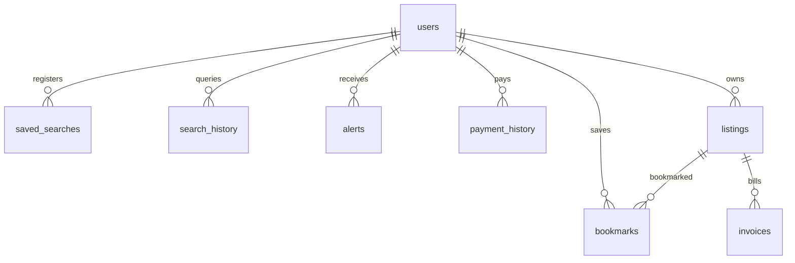

# The Watch Box (WatchSphere) — Mobile Application & API Specification

**The Watch Box** is an enterprise-grade, high-fidelity luxury watch marketplace and intelligence mobile application built with **Flutter**, **GetX**, and **SQLite**. It aggregates luxury timepieces across tier-1 global marketplaces (**Chrono24**, **eBay**, and **Grailzee**), offering real-time market value spreads, vector cubic Bezier price trend charts, visual AI watch detection, watchlists, saved search alerts, peer-to-peer trader listing capabilities, and an administrative control suite.

This document serves as the master documentation for the mobile application codebase, detailing all features, controllers, local database tables, their corresponding backend REST API endpoints from `watchBox-Backend`, and clearly highlighting features that currently have **No endpoint for that**.

---

## 📑 Table of Contents
1. [📱 System Architecture & Tech Stack](#-system-architecture--tech-stack)
2. [📁 Project Directory Structure](#-project-directory-structure)
3. [📬 Postman API Collection (`collection.json`)](#-postman-api-collection-collectionjson)
4. [🗺️ Complete Feature & Backend API Mapping Matrix](#-complete-feature--backend-api-mapping-matrix)
   - [1. Authentication & Session Management](#1-authentication--session-management)
   - [2. User Profile, Preferences & Settings](#2-user-profile-preferences--settings)
   - [3. Search, Discovery & Multi-Platform Aggregation](#3-search-discovery--multi-platform-aggregation)
   - [4. Search Quota & Monthly Tier Limitations](#4-search-quota--monthly-tier-limitations)
   - [5. Saved Searches & Search Alerts](#5-saved-searches--search-alerts)
   - [6. Bookmarks & Watchlists](#6-bookmarks--watchlists)
   - [7. Watch Details, Market Metrics & Outbound Redirection](#7-watch-details-market-metrics--outbound-redirection)
   - [8. Price Trend Curves & Market Analytics](#8-price-trend-curves--market-analytics)
   - [9. Visual Watch Image Search & AI Detection](#9-visual-watch-image-search--ai-detection)
   - [10. Push Notifications, Price Drop & Listing Alerts](#10-push-notifications-price-drop--listing-alerts)
   - [11. Peer-to-Peer Marketplace & Trader Listings](#11-peer-to-peer-marketplace--trader-listings)
   - [12. In-App Purchasing, Orders & Invoicing](#12-in-app-purchasing-orders--invoicing)
   - [13. Subscriptions, Tier Access & Stripe Billing](#13-subscriptions-tier-access--stripe-billing)
   - [14. Social Sharing & Listing Export](#14-social-sharing--listing-export)
   - [15. Admin Dashboard, Platform Toggles & System Diagnostics](#15-admin-dashboard-platform-toggles--system-diagnostics)
   - [16. Automation & Social Media Campaigns](#16-automation--social-media-campaigns)
5. [⚠️ Summary of Features with "NO ENDPOINT FOR THAT"](#-summary-of-features-with-no-endpoint-for-that)
6. [🗄️ Local SQLite Database Architecture (`watch_sphere.db`)](#-local-sqlite-database-architecture-watch_spheredb)
7. [🚀 Getting Started & Local Execution](#-getting-started--local-execution)

---

## 📱 System Architecture & Tech Stack

### Frontend Mobile App (`the_watch_box`)
- **Framework:** Flutter (`^3.44.0`), Dart (`^3.12.1`)
- **State Management & DI:** GetX (`get`) for reactive MVC controllers, snackbars, modals, and route bindings
- **Screen Responsiveness:** `flutter_screenutil` (Target design size: `390 x 844`)
- **Offline / Local Persistence:** SQLite via `sqflite` (database file: `watch_sphere.db`)
- **Client Cache & Flags:** `shared_preferences` (`PrefManager`) for dark mode, onboarding, user credentials, and admin integration toggles
- **Custom Graphics:** Handcrafted `CustomPainter` vector engines (`CustomPriceChart` for cubic Bezier trend curves, watermark gear dials)

### Backend API & Workers (`watchBox-Backend`)
- **Runtime:** Node.js (`>=22.11.0`), TypeScript, Express (`^4.21.2`)
- **Database:** MongoDB & Mongoose (`^8.9.5`), Redis (`ioredis ^5.4.2`), RabbitMQ (`amqplib ^0.10.5`)
- **Authentication:** JWT Bearer tokens (Customer & Admin), Argon2 password hashing
- **Storage & Ingestion:** AWS S3 SDK for presigned image uploads, Sharp for image processing

---

## 📁 Project Directory Structure

```
lib/
├── main.dart                               # Application bootstrap, DI bindings & route table
├── core/
│   ├── db/
│   │   └── db_helper.dart                  # SQLite openDatabase helper, migrations, and seed dataset
│   ├── prefs/
│   │   └── pref_manager.dart               # SharedPreferences wrapper for session flags & platform toggles
│   └── theme/
│       ├── app_colors.dart                 # Hex color palette (Navy Blue, Dial Accents, Gold, Slates)
│       └── app_theme.dart                  # Dark & Light ThemeData definitions
├── models/
│   ├── alert_model.dart                    # Price drop and new listing notifications
│   ├── bookmark_model.dart                 # Saved listing references
│   ├── search_query_model.dart             # Bookmarked queries with JSON filters
│   ├── user_model.dart                     # User entity (role: user/admin, plan: free/paid)
│   └── watch_model.dart                    # Watch listing entity (eBay, Chrono24, Grailzee, In-App)
├── controllers/
│   ├── admin_controller.dart               # Admin dashboard, integrations toggle, billing editor
│   ├── alert_controller.dart               # Notifications feed, unread counters, mark-read
│   ├── auth_controller.dart                # User auth, session manager, plan upgrade/downgrade
│   ├── bookmark_controller.dart             # Bookmarks toggle and saved searches
│   ├── onboarding_controller.dart          # 3-step carousel controller
│   └── search_controller.dart               # Multi-platform search, filter logic, limit check, P2P transactions
└── views/
    ├── splash/splash_screen.dart            # Rotating watermark gear dials & loading bar
    ├── onboarding/onboarding_screen.dart    # 3-step feature onboarding pager
    ├── auth/login_screen.dart               # Fast mockup profile switcher & passwordless login
    ├── home/
    │   ├── home_screen.dart                 # MainContainerScreen with bottom navigation bar
    │   ├── watch_detail_screen.dart         # Hero view, price trend curve, specs, outbound & buy sheet
    │   ├── traders_collections_screen.dart  # In-app peer-to-peer watch listings
    │   └── tabs/
    │       ├── home_tab.dart                # Home dashboard, indices, trending listings
    │       ├── search_tab.dart              # Multi-platform search grid & filter drawer
    │       ├── bookmarks_tab.dart           # Bookmarked listings & saved searches tabs
    │       ├── alerts_tab.dart              # Notifications feed (price drops & new listings)
    │       └── profile_tab.dart             # Profile stats, plan gauge, settings & theme toggle
    ├── profile/
    │   ├── account_settings_screen.dart     # Account details and settings
    │   ├── change_password_screen.dart      # Password modification form
    │   ├── invoice_preview_screen.dart      # Standard luxury billing invoice preview & PDF export
    │   ├── my_listings_screen.dart          # User's active & sold listings with invoice creation
    │   ├── notifications_screen.dart        # Expanded notification center
    │   └── subscription_plans_screen.dart   # Plan comparison (Free vs Paid vs VIP)
    ├── search/image_search_screen.dart      # Camera / visual similarity watch search
    ├── admin/admin_dashboard.dart           # Admin metrics, user manager, toggles, hardware latency
    └── widgets/
        ├── custom_chart.dart                # Vector Cubic Bezier PriceTrendChart painter
        ├── watch_background.dart            # Radial luxury gradient background
        └── navbar/custom_navbar.dart        # Floating navy navigation bar with badge dots
```

---

## 📬 Postman API Collection (`collection.json`)

A complete, fully documented, pre-configured **Postman Collection (v2.1.0)** is included in the root directory:
👉 [`collection.json`](file:///d:/nahid/the_watch_box/the_watch_box/collection.json)

### Collection Structure:
1. `01. Authentication & Sessions` (12 endpoints)
2. `02. User Profile & Preferences` (12 endpoints)
3. `03. Search & Discovery` (7 endpoints)
4. `04. Image Search & AI Detection` (8 endpoints)
5. `05. Watch Details & Catalog` (17 endpoints)
6. `06. Price Trend & Market Analytics` (33 endpoints)
7. `07. Bookmarks & Watchlists` (11 endpoints)
8. `08. Saved Searches & Search Alerts` (9 endpoints)
9. `09. Notifications & Price Drop Alerts` (12 endpoints)
10. `10. Peer-to-Peer Marketplace & Trader Listings` (37 endpoints)
11. `11. In-App Orders & Transactions` (12 endpoints)
12. `12. Subscriptions & Quota (5 Searches/mo Check)` (10 endpoints)
13. `13. Support, Content & Reports` (13 endpoints)
14. `14. Admin Panel & Controls` (157 endpoints)
15. `15. Platform Webhooks` (4 endpoints)

### Configured Environment Variables:
| Variable | Default Value | Description |
| :--- | :--- | :--- |
| `baseUrl` | `http://localhost:4000` | Target backend host and port |
| `accessToken` | `""` | Customer JWT Bearer access token |
| `refreshToken` | `""` | Refresh token for session renewal |
| `adminToken` | `""` | Administrator JWT Bearer token |
| `listingId` | `64f000000000000000000001` | Sample MongoDB Listing ObjectId |
| `watchModelId` | `64f000000000000000000002` | Sample Watch Model ObjectId |
| `savedSearchId` | `64f000000000000000000003` | Sample Saved Search ObjectId |
| `watchlistId` | `64f000000000000000000004` | Sample Watchlist ObjectId |
| `orderId` | `64f000000000000000000006` | Sample Purchase Order ObjectId |

---

## 🗺️ Complete Feature & Backend API Mapping Matrix

Below is the exhaustive mapping between **every function and feature in the mobile application** and the corresponding **Backend API endpoint** in `watchBox-Backend`. Features that are currently executed client-side or lack a backend implementation are explicitly labeled with **No endpoint for that**.

---

### 1. Authentication & Session Management

| App Feature / Function | Mobile Implementation (`lib/`) | Backend API Endpoint | Auth Type | Status & Implementation Notes |
| :--- | :--- | :--- | :--- | :--- |
| **Customer Registration** | `AuthController.login()` / Registration | `POST /api/v1/auth/register` | Public | **Connected Endpoint**. Creates user account with email, password, and displayName. |
| **Customer Login** | `AuthController.login()` (`auth_controller.dart`) | `POST /api/v1/auth/login` | Public | **Connected Endpoint**. Returns JWT `accessToken`, `refreshToken`, and user object. |
| **Refresh Access Token** | `AuthController._loadUserSession()` | `POST /api/v1/auth/refresh` | Public | **Connected Endpoint**. Uses `refreshToken` to issue fresh `accessToken`. |
| **Logout Active Session** | `AuthController.logout()` (`auth_controller.dart`) | `POST /api/v1/auth/logout` | Customer Bearer | **Connected Endpoint**. Blacklists current session token on the server. |
| **Logout All Devices** | `AccountSettingsScreen` | `POST /api/v1/auth/logout-all` | Customer Bearer | **Connected Endpoint**. Revokes all active sessions for this account. |
| **Forgot Password Request** | `LoginScreen` (Forgot password link) | `POST /api/v1/auth/forgot-password` | Public | **Connected Endpoint**. Triggers verification reset email. |
| **Reset Password with Token** | Password reset view | `POST /api/v1/auth/reset-password` | Public | **Connected Endpoint**. Validates reset token and sets new password. |
| **Change Password** | `ChangePasswordScreen` (`change_password_screen.dart`) | `POST /api/v1/auth/change-password` | Customer Bearer | **Connected Endpoint**. Requires `currentPassword` and `newPassword`. |
| **List Active Sessions** | `AccountSettingsScreen` (Connected Devices) | `GET /api/v1/auth/sessions` | Customer Bearer | **Connected Endpoint**. Returns list of active sessions with IP and user-agent. |
| **Revoke Specific Session** | `AccountSettingsScreen` (Terminate Device) | `DELETE /api/v1/auth/sessions/:sessionId` | Customer Bearer | **Connected Endpoint**. Revokes single session by ID. |
| **Developer Test Bypass Login** | `LoginScreen.dart` (`_submit()`) | **No endpoint for that** | Local Client | **No endpoint for that**. Fast developer bypass enabling instant login by typing any name and selecting Free/Paid role. Stored directly in local SQLite `users` table. |

---

### 2. User Profile, Preferences & Settings

| App Feature / Function | Mobile Implementation (`lib/`) | Backend API Endpoint | Auth Type | Status & Implementation Notes |
| :--- | :--- | :--- | :--- | :--- |
| **Get Current User Profile** | `AuthController._loadUserSession()` | `GET /api/v1/users/me` | Customer Bearer | **Connected Endpoint**. Returns user profile, active tier, and verification status. |
| **Update Profile Info** | `AccountSettingsScreen` (`account_settings_screen.dart`) | `PATCH /api/v1/users/me` | Customer Bearer | **Connected Endpoint**. Updates `displayName`, `phone`, `country`, and contact info. |
| **Delete Account** | `AccountSettingsScreen` (Delete Account) | `DELETE /api/v1/users/me` | Customer Bearer | **Connected Endpoint**. Soft deletes account and removes active tokens. |
| **Get Dark Mode Preference** | `AppTheme` / `PrefManager.isDarkMode` | `GET /api/v1/users/me/dark-mode` | Customer Bearer | **Connected Endpoint**. Fetches user dark mode preference from server. |
| **Update Dark Mode Preference** | `ProfileTab` (Theme toggle switch) | `PATCH /api/v1/users/me/dark-mode` | Customer Bearer | **Connected Endpoint**. Syncs dark mode preference to cloud database. |
| **Get Regional Preferences** | `ProfileTab` (Currency selection) | `GET /api/v1/users/me/preferences` | Customer Bearer | **Connected Endpoint**. Returns preferred currency (USD, EUR, GBP). |
| **Update Regional Preferences**| `ProfileTab` (Currency picker) | `PATCH /api/v1/users/me/preferences` | Customer Bearer | **Connected Endpoint**. Updates default display currency on backend. |
| **Avatar Presigned S3 URL** | `ProfileTab` (Avatar tap) | `POST /api/v1/users/me/avatar/upload-url` | Customer Bearer | **Connected Endpoint**. Generates S3 presigned PUT URL for profile picture. |
| **Confirm Avatar Upload** | `ProfileTab` (Avatar upload listener) | `POST /api/v1/users/me/avatar/confirm` | Customer Bearer | **Connected Endpoint**. Confirms S3 image key and updates profile picture. |
| **Delete Avatar Image** | `ProfileTab` (Remove photo) | `DELETE /api/v1/users/me/avatar` | Customer Bearer | **Connected Endpoint**. Resets avatar to default initials placeholder. |

---

### 3. Search, Discovery & Multi-Platform Aggregation

| App Feature / Function | Mobile Implementation (`lib/`) | Backend API Endpoint | Auth Type | Status & Implementation Notes |
| :--- | :--- | :--- | :--- | :--- |
| **Multi-Platform Search** | `WatchSearchController.executeSearch()` (`search_tab.dart`) | `GET /api/v1/search` | Customer Bearer | **Connected Endpoint**. Aggregates eBay, Chrono24, and Grailzee listings with query, price min/max, platform chips, year, condition, location, and status. |
| **Search Autocomplete** | `SearchTab` (Search input listener) | `GET /api/v1/search/suggestions` | Customer Bearer | **Connected Endpoint**. Returns predictive suggestions for watch brands and models. |
| **Popular / Trending Searches**| `SearchTab` (Trending keyword pills) | `GET /api/v1/search/popular` | Customer Bearer | **Connected Endpoint**. Returns top queried watch models across platforms. |
| **Search Filter Facets** | `SearchTab` (Filter drawer counters) | `GET /api/v1/search/facets` | Customer Bearer | **Connected Endpoint**. Returns counts per brand, condition, and price bracket. |
| **Preview Match Count** | `SearchTab` (Filter drawer button) | `POST /api/v1/search/preview-count` | Customer Bearer | **Connected Endpoint**. Pre-calculates result count before applying filter drawer. |
| **Search History Retrieval** | `WatchSearchController.loadSearchHistory()` | `GET /api/v1/search/recent` | Customer Bearer | **Connected Endpoint**. Fetches 10 recent searches stored for current user. |
| **Clear Search History** | `WatchSearchController.clearHistory()` | `DELETE /api/v1/search/recent` | Customer Bearer | **Connected Endpoint**. Deletes user recent search query history. |
| **Local SQLite Fallback Search** | `WatchSearchController.executeSearch()` | **No endpoint for that** | Local SQLite | **No endpoint for that**. Executes offline full-text SQL queries against `listings` table when network is unavailable or in demo mode. |

---

### 4. Search Quota & Monthly Tier Limitations

| App Feature / Function | Mobile Implementation (`lib/`) | Backend API Endpoint | Auth Type | Status & Implementation Notes |
| :--- | :--- | :--- | :--- | :--- |
| **Check Monthly Search Quota** | `WatchSearchController.checkSearchLimit()` | `GET /api/v1/subscriptions/me/usage` | Customer Bearer | **Connected Endpoint**. Returns current monthly searches performed versus plan limit. |
| **Enforce 5 Searches/mo Free** | `WatchSearchController.monthlySearchCount` | `GET /api/v1/subscriptions/me/usage` | Customer Bearer | **Connected Endpoint**. Checks if `count >= 5` on Free tier. |
| **Upgrade Modal Dialog** | `WatchSearchController._buildUpgradeDialog()` | **No endpoint for that** | Local UI Modal | **No endpoint for that**. Custom Flutter modal prompting user to upgrade to Premium ($29/mo) after 5 searches. |

---

### 5. Saved Searches & Search Alerts

| App Feature / Function | Mobile Implementation (`lib/`) | Backend API Endpoint | Auth Type | Status & Implementation Notes |
| :--- | :--- | :--- | :--- | :--- |
| **Fetch Saved Searches** | `BookmarkController.fetchSavedSearches()` | `GET /api/v1/saved-searches` | Customer Bearer | **Connected Endpoint**. Returns saved searches with filters, chips, and alert status. |
| **Save Search Query & Filters**| `BookmarkController.saveSearch()` | `POST /api/v1/saved-searches` | Customer Bearer | **Connected Endpoint**. Saves query string with JSON filter configuration. |
| **Run Saved Search** | `BookmarksTab` (Tap saved search card) | `POST /api/v1/saved-searches/:savedSearchId/run` | Customer Bearer | **Connected Endpoint**. Re-runs the saved query and returns latest listings. |
| **Enable Price Drop Alerts** | `BookmarksTab` (Alert bell icon toggle) | `POST /api/v1/saved-searches/:savedSearchId/alerts/enable` | Customer Bearer | **Connected Endpoint**. Enables notification push for price drops on this query. |
| **Disable Search Alerts** | `BookmarksTab` (Alert bell icon toggle) | `POST /api/v1/saved-searches/:savedSearchId/alerts/disable` | Customer Bearer | **Connected Endpoint**. Disables notifications for this saved query. |
| **Delete Saved Search** | `BookmarkController.removeSavedSearch()` | `DELETE /api/v1/saved-searches/:savedSearchId` | Customer Bearer | **Connected Endpoint**. Deletes saved search record from database. |
| **Get Saved Search Matches** | `BookmarksTab` (Badge count matches) | `GET /api/v1/saved-searches/:savedSearchId/matches` | Customer Bearer | **Connected Endpoint**. Returns newly matching listings since last run. |

---

### 6. Bookmarks & Watchlists

| App Feature / Function | Mobile Implementation (`lib/`) | Backend API Endpoint | Auth Type | Status & Implementation Notes |
| :--- | :--- | :--- | :--- | :--- |
| **Save / Bookmark Listing** | `BookmarkController.toggleBookmark()` | `POST /api/v1/listings/:listingId/save` | Customer Bearer | **Connected Endpoint**. Saves listing to user bookmarks. |
| **Remove Bookmark** | `BookmarkController.toggleBookmark()` | `DELETE /api/v1/listings/:listingId/save` | Customer Bearer | **Connected Endpoint**. Removes listing from user bookmarks. |
| **Get Saved Listings** | `BookmarkController.fetchBookmarks()` | `GET /api/v1/me/saved-listings` | Customer Bearer | **Connected Endpoint**. Retrieves full list of bookmarked watch listings. |
| **Named Watchlists Management**| `BookmarksTab` / Watchlists | `GET /api/v1/watchlists` & `POST /api/v1/watchlists` | Customer Bearer | **Connected Endpoint**. Supports custom named folders/watchlists. |

---

### 7. Watch Details, Market Metrics & Outbound Redirection

| App Feature / Function | Mobile Implementation (`lib/`) | Backend API Endpoint | Auth Type | Status & Implementation Notes |
| :--- | :--- | :--- | :--- | :--- |
| **Get Listing Full Details** | `WatchDetailScreen` (`watch_detail_screen.dart`)| `GET /api/v1/listings/:listingId` | Customer Bearer | **Connected Endpoint**. Fetches high-res photos, description, condition, and specs. |
| **Get Similar Listings** | `WatchDetailScreen` (Similar carousel) | `GET /api/v1/listings/:listingId/similar` | Customer Bearer | **Connected Endpoint**. Fetches comparable listings of the same model. |
| **Get Seller / Trader Profile**| `WatchDetailScreen` (Verified seller card) | `GET /api/v1/listings/:listingId/seller` | Customer Bearer | **Connected Endpoint**. Returns seller rating, verified badge, and location. |
| **Record Listing View** | `WatchDetailScreen.initState()` | `POST /api/v1/listings/:listingId/view` | Customer Bearer | **Connected Endpoint**. Increments listing views for demand tracking. |
| **Report Suspicious Listing** | `WatchDetailScreen` (Report option) | `POST /api/v1/listings/:listingId/report` | Customer Bearer | **Connected Endpoint**. Submits listing report for counterfeit / fraudulent items. |
| **Contact Seller / Inquiry** | `WatchDetailScreen` (Message seller button) | `POST /api/v1/listings/:listingId/contact-seller` | Customer Bearer | **Connected Endpoint**. Sends inquiry message to the watch seller. |
| **Marketplace Outbound Link** | `WatchDetailScreen._simulatePlatformRedirect()` | `GET /api/v1/listings/:listingId/outbound-link` | Customer Bearer | **Connected Endpoint**. Generates affiliate/tracked external redirect URL to eBay, Chrono24, or Grailzee. |
| **Parallax Hero Image Effect** | `WatchDetailScreen._onScroll()` | **No endpoint for that** | Client UI Animation | **No endpoint for that**. Custom Flutter `ScrollController` listener calculating offset * 0.4 for smooth image parallax. |
| **Animated Price Counter Ticker** | `WatchDetailScreen._priceCountAnimation` | **No endpoint for that** | Client UI Animation | **No endpoint for that**. `AnimationController` ticking price numbers upward using `Curves.easeOutCubic`. |

---

### 8. Price Trend Curves & Market Analytics

| App Feature / Function | Mobile Implementation (`lib/`) | Backend API Endpoint | Auth Type | Status & Implementation Notes |
| :--- | :--- | :--- | :--- | :--- |
| **Model Market Summary** | `WatchDetailScreen` & `SearchTab` | `GET /api/v1/watch-models/:watchModelId/market-summary` | Customer Bearer | **Connected Endpoint**. Returns lowest, highest, and average market price. |
| **Monthly Price Trend History**| `CustomPriceChart` (`custom_chart.dart`) | `GET /api/v1/analytics/watch-models/:watchModelId/price-trend` | Customer Bearer | **Connected Endpoint**. Returns historical price points for rendering vector chart. |
| **Listing Value Comparison** | `WatchDetailScreen` (Market Spread Badge) | `GET /api/v1/analytics/listings/:listingId/value-comparison` | Customer Bearer | **Connected Endpoint**. Compares current price against 90-day moving average. |
| **Model Volatility & Liquidity**| `WatchDetailScreen` (Volatility Index) | `GET /api/v1/analytics/watch-models/:watchModelId/volatility` | Customer Bearer | **Connected Endpoint**. Returns liquidity rating and price volatility score. |
| **Cubic Bezier CustomPainter** | `PriceTrendPainter` (`custom_chart.dart`) | **No endpoint for that** | Client Vector Engine | **No endpoint for that**. Handcrafted Flutter `CustomPainter` calculating cubic Bezier control points and gradients locally. |

---

### 9. Visual Watch Image Search & AI Detection

| App Feature / Function | Mobile Implementation (`lib/`) | Backend API Endpoint | Auth Type | Status & Implementation Notes |
| :--- | :--- | :--- | :--- | :--- |
| **Request Image Upload URL** | `ImageSearchScreen` (Camera shutter tap) | `POST /api/v1/image-search/upload-url` | Customer Bearer | **Connected Endpoint**. Issues presigned S3 URL for photo upload. |
| **Execute Visual AI Search** | `ImageSearchScreen` (Search trigger) | `POST /api/v1/image-search` | Customer Bearer | **Connected Endpoint**. Generates visual embeddings and finds nearest watch models. |
| **Fetch Image Search Results** | `ImageSearchScreen` (Results grid) | `GET /api/v1/image-search/:searchId/results` | Customer Bearer | **Connected Endpoint**. Returns matched listings ranked by similarity score. |
| **Recent Image Search Scans** | `ImageSearchScreen` (Recent scans strip) | `GET /api/v1/image-search/recent` | Customer Bearer | **Connected Endpoint**. Returns history of user camera watch scans. |
| **Submit AI Search Feedback** | `ImageSearchScreen` (Accuracy feedback) | `POST /api/v1/image-search/:searchId/feedback` | Customer Bearer | **Connected Endpoint**. Allows user to confirm or correct identified model. |
| **Auto-Detect Listing Specs** | `MyListingsScreen` (Photo auto-fill) | `POST /api/v1/listings/:listingId/auto-detect` | Customer Bearer | **Connected Endpoint**. Extracts brand, model, and year from watch dial photo. |
| **Local Simulated Image Asset** | `WatchSearchController.runSimulatedImageSearch()` | **No endpoint for that** | Local Mock Asset | **No endpoint for that**. Uses bundled assets (e.g. `assets/images/watches/rolex.jpg`) for demo testing. |

---

### 10. Push Notifications, Price Drop & Listing Alerts

| App Feature / Function | Mobile Implementation (`lib/`) | Backend API Endpoint | Auth Type | Status & Implementation Notes |
| :--- | :--- | :--- | :--- | :--- |
| **Fetch Notification Feed** | `AlertController.fetchAlerts()` (`alerts_tab.dart`)| `GET /api/v1/notifications` | Customer Bearer | **Connected Endpoint**. Returns user alerts for price drops, sales, and new listings. |
| **Unread Notification Count** | `AlertController.unreadCount` / `CustomNavbar` | `GET /api/v1/notifications/unread-count` | Customer Bearer | **Connected Endpoint**. Powers red badge indicator on bottom navigation bar. |
| **Mark Notification as Read** | `AlertController.markAsRead()` | `POST /api/v1/notifications/:notificationId/read` | Customer Bearer | **Connected Endpoint**. Marks single alert read on server. |
| **Mark All Notifications Read**| `AlertController.markAllAsRead()` | `POST /api/v1/notifications/read-all` | Customer Bearer | **Connected Endpoint**. Clears all unread badges across the account. |
| **Delete Notification Item** | `AlertController.deleteAlert()` | `DELETE /api/v1/notifications/:notificationId` | Customer Bearer | **Connected Endpoint**. Permanently deletes alert from user feed. |
| **Real-Time Notification Stream**| `AlertController` SSE Listener | `GET /api/v1/notifications/stream` | Customer Bearer | **Connected Endpoint**. Server-Sent Events (SSE) stream for real-time alerts. |
| **Register FCM/APNS Push Token**| `main.dart` Device Registration | `POST /api/v1/devices` | Customer Bearer | **Connected Endpoint**. Registers mobile device push notification token. |
| **Simulated Price Drop Trigger**| `AlertController.triggerSimulatedPriceDropAlert()`| **No endpoint for that** | Local Demo Simulator | **No endpoint for that**. Client-side test method inserting fake price drops into local SQLite `alerts` table. (In production, executed by backend worker `src/workers/run.ts`). |

---

### 11. Peer-to-Peer Marketplace & Trader Listings

| App Feature / Function | Mobile Implementation (`lib/`) | Backend API Endpoint | Auth Type | Status & Implementation Notes |
| :--- | :--- | :--- | :--- | :--- |
| **Browse Trader Collections** | `TradersCollectionsScreen` (`traders_collections_screen.dart`)| `GET /api/v1/trader-collection` | Customer Bearer | **Connected Endpoint**. Fetches peer-to-peer watch listings published in-app. |
| **Featured Trader Highlights** | `HomeTab` (Featured Trader Carousel) | `GET /api/v1/trader-collection/featured` | Customer Bearer | **Connected Endpoint**. Returns featured certified peer traders. |
| **Create In-App Watch Listing** | `MyListingsScreen._showAddListingSheet()` | `POST /api/v1/listings` | Customer Bearer | **Connected Endpoint**. Submits new listing (brand, model, title, price, year, condition, location). |
| **Upload Listing Images** | `MyListingsScreen` Image Uploader | `POST /api/v1/listings/:listingId/images/upload-urls` | Customer Bearer | **Connected Endpoint**. Requests S3 presigned upload URLs for listing gallery. |
| **Confirm Listing Images** | `MyListingsScreen` Image Confirmer | `POST /api/v1/listings/:listingId/images/confirm` | Customer Bearer | **Connected Endpoint**. Confirms image upload keys in S3. |
| **Submit Listing for Approval**| `MyListingsScreen` | `POST /api/v1/listings/:listingId/submit` | Customer Bearer | **Connected Endpoint**. Moves listing from Draft to Pending Review. |
| **Publish Listing** | `MyListingsScreen` | `POST /api/v1/listings/:listingId/publish` | Customer Bearer | **Connected Endpoint**. Publishes listing directly to the active marketplace. |
| **Fetch My Active Listings** | `MyListingsScreen` (Active tab) | `GET /api/v1/me/listings/active` | Customer Bearer | **Connected Endpoint**. Retrieves listings published by current user. |
| **Fetch My Sold Listings** | `MyListingsScreen` (Sold tab) | `GET /api/v1/me/listings/sold` | Customer Bearer | **Connected Endpoint**. Retrieves sold items published by current user. |
| **Mark Listing as Sold** | `WatchSearchController.buyListing()` | `POST /api/v1/listings/:listingId/mark-sold` | Customer Bearer | **Connected Endpoint**. Updates listing state to Sold. |
| **Reserve / Hold Listing** | Peer Trade Negotiation | `POST /api/v1/listings/:listingId/reserve` | Customer Bearer | **Connected Endpoint**. Temporarily reserves listing during pending buyer payment. |

---

### 12. In-App Purchasing, Orders & Invoicing

| App Feature / Function | Mobile Implementation (`lib/`) | Backend API Endpoint | Auth Type | Status & Implementation Notes |
| :--- | :--- | :--- | :--- | :--- |
| **Buy Peer Listing (Create Order)**| `WatchDetailScreen._showBuyConfirmSheet()` | `POST /api/v1/orders` | Customer Bearer | **Connected Endpoint**. Creates an in-app purchase order and marks listing as sold. |
| **Get Order Details** | Order Confirmation View | `GET /api/v1/orders/:orderId` | Customer Bearer | **Connected Endpoint**. Returns order details, escrow status, and tracking numbers. |
| **Get User Purchase Orders** | `ProfileTab` / Order History | `GET /api/v1/me/orders` | Customer Bearer | **Connected Endpoint**. Lists user purchase transactions. |
| **Order Payment Intent** | In-app Checkout Screen | `POST /api/v1/orders/:orderId/payment-intent` | Customer Bearer | **Connected Endpoint**. Creates Stripe payment intent for luxury watch escrow. |
| **Confirm Shipment** | `MyListingsScreen` (Sold item shipping) | `POST /api/v1/orders/:orderId/confirm-shipment` | Customer Bearer | **Connected Endpoint**. Seller inputs insured courier tracking code. |
| **Confirm Delivery** | Buyer Confirmation View | `POST /api/v1/orders/:orderId/confirm-delivery` | Customer Bearer | **Connected Endpoint**. Buyer verifies receipt and releases escrow payout. |
| **Custom Peer Invoice Generation**| `MyListingsScreen._showGenerateInvoiceDialog()` | **No endpoint for that** | Local SQLite | **No endpoint for that**. Generates custom invoice record (`buyer_name`, `buyer_email`, `invoice_no`, `date`, `price`) stored in SQLite `invoices` table. *Backend has subscription invoices at `GET /api/v1/subscriptions/invoices`, but lacks a custom P2P trade invoice generator endpoint.* |
| **Invoice PDF Export & Print** | `InvoicePreviewScreen._simulateExport()` | **No endpoint for that** | Client PDF / Print | **No endpoint for that**. Renders formal invoice view and simulates OS print / PDF export locally. |

---

### 13. Subscriptions, Tier Access & Stripe Billing

| App Feature / Function | Mobile Implementation (`lib/`) | Backend API Endpoint | Auth Type | Status & Implementation Notes |
| :--- | :--- | :--- | :--- | :--- |
| **List Available Plans** | `SubscriptionPlansScreen` (`subscription_plans_screen.dart`)| `GET /api/v1/subscriptions/plans` | Public | **Connected Endpoint**. Returns Free ($0), Premium ($29/mo), and VIP ($49/mo) plans. |
| **Get User Active Subscription**| `ProfileTab` (Current Plan Gauge) | `GET /api/v1/subscriptions/me` | Customer Bearer | **Connected Endpoint**. Returns active tier, billing cycle, and expiration. |
| **Create Stripe Checkout Session**| `SubscriptionPlansScreen` (Upgrade button) | `POST /api/v1/subscriptions/checkout-session` | Customer Bearer | **Connected Endpoint**. Generates Stripe hosted checkout session for subscription. |
| **Customer Billing Portal** | `ProfileTab` (Manage Billing) | `POST /api/v1/subscriptions/portal-session` | Customer Bearer | **Connected Endpoint**. Opens Stripe Customer Portal for card and payment management. |
| **Change / Upgrade Plan** | `AuthController.upgradePlan()` | `POST /api/v1/subscriptions/change-plan` | Customer Bearer | **Connected Endpoint**. Upgrades plan tier and computes prorated billing. |
| **Cancel Subscription** | `SubscriptionPlansScreen` (Cancel tier) | `POST /api/v1/subscriptions/cancel` | Customer Bearer | **Connected Endpoint**. Cancels recurring subscription at period end. |
| **Get Subscription Invoices** | `ProfileTab` (Billing History) | `GET /api/v1/subscriptions/invoices` | Customer Bearer | **Connected Endpoint**. Returns PDF invoice history for membership fees. |
| **Local Payment History Log** | `AuthController.upgradePlan()` | **No endpoint for that** | Local SQLite | **No endpoint for that**. Inserts local record into SQLite `payment_history` table for offline verification. |

---

### 14. Social Sharing & Listing Export

| App Feature / Function | Mobile Implementation (`lib/`) | Backend API Endpoint | Auth Type | Status & Implementation Notes |
| :--- | :--- | :--- | :--- | :--- |
| **Share via WhatsApp** | `WatchDetailScreen._buildShareOption()` | **No endpoint for that** | Client OS Intent | **No endpoint for that**. Native URL scheme `whatsapp://send?text=...`. |
| **Share via Facebook** | `WatchDetailScreen._buildShareOption()` | **No endpoint for that** | Client OS Intent | **No endpoint for that**. Native Facebook sharing intent. |
| **Share via Messenger** | `WatchDetailScreen._buildShareOption()` | **No endpoint for that** | Client OS Intent | **No endpoint for that**. Native Messenger URL scheme. |
| **Copy Listing Link to Clipboard**| `WatchDetailScreen._buildShareOption()` | **No endpoint for that** | Flutter Clipboard | **No endpoint for that**. `Clipboard.setData(ClipboardData(text: ...))`. |

---

### 15. Admin Dashboard, Platform Toggles & System Diagnostics

| App Feature / Function | Mobile Implementation (`lib/`) | Backend API Endpoint | Auth Type | Status & Implementation Notes |
| :--- | :--- | :--- | :--- | :--- |
| **Admin Panel Authentication** | `AdminDashboard` (`admin_dashboard.dart`) | `POST /api/v1/admin/auth/login` | Admin Public | **Connected Endpoint**. Authenticates administrative credentials and returns admin JWT. |
| **Admin Dashboard Summary** | `AdminDashboard` (Top metric cards) | `GET /api/v1/admin/dashboard/summary` | Admin Bearer | **Connected Endpoint**. Returns aggregated user count, revenue trends, and search volumes. |
| **Admin List All Users** | `AdminController.fetchUsers()` | `GET /api/v1/admin/users` | Admin Bearer | **Connected Endpoint**. Returns all users with plan tiers and status. |
| **Admin Update User Details** | `AdminController.updateUser()` | `PATCH /api/v1/admin/users/:userId/profile` | Admin Bearer | **Connected Endpoint**. Updates user roles, email, or profile attributes. |
| **Admin Deactivate / Suspend User**| `AdminController.updateUser(status: 'inactive')`| `PATCH /api/v1/admin/users/:userId/status` | Admin Bearer | **Connected Endpoint**. Activates, suspends, or deactivates user accounts. |
| **List Marketplace Integrations** | `AdminDashboard` (Marketplace status) | `GET /api/v1/admin/marketplaces` | Admin Bearer | **Connected Endpoint**. Returns eBay, Chrono24, and Grailzee sync status. |
| **Globally Toggle eBay** | `AdminController.toggleEbay()` | `POST /api/v1/admin/marketplaces/:marketplaceId/enable` / `disable` | Admin Bearer | **Connected Endpoint**. Controls platform ingestion globally. |
| **Globally Toggle Chrono24** | `AdminController.toggleChrono24()` | `POST /api/v1/admin/marketplaces/:marketplaceId/enable` / `disable` | Admin Bearer | **Connected Endpoint**. Controls platform ingestion globally. |
| **Globally Toggle Grailzee** | `AdminController.toggleGrailzee()` | `POST /api/v1/admin/marketplaces/:marketplaceId/enable` / `disable` | Admin Bearer | **Connected Endpoint**. Controls platform ingestion globally. |
| **List Platform Feature Toggles** | `AdminDashboard` (Feature toggles) | `GET /api/v1/admin/settings/features` | Admin Bearer | **Connected Endpoint**. Returns global feature flags (image search, ads, volatility). |
| **Toggle Feature (Image Search/Ads)**| `AdminController.toggleImageSearch() / toggleAds()` | `PATCH /api/v1/admin/settings/features/:featureKey` | Admin Bearer | **Connected Endpoint**. Persists platform feature flags dynamically. |
| **Edit Premium Plan Pricing** | `AdminController.editPremiumPrice()` | `PATCH /api/v1/admin/subscriptions/plans/:planId` | Admin Bearer | **Connected Endpoint**. Updates subscription tier pricing on the server. |
| **Admin Financial Transactions Log**| `AdminController.fetchPaymentHistory()` | `GET /api/v1/admin/earnings/transactions` | Admin Bearer | **Connected Endpoint**. Returns transaction receipts, payouts, and customer details. |
| **Server Health & Uptime** | `AdminDashboard` (Diagnostics) | `GET /health` | Public | **Connected Endpoint**. Returns server status, uptime seconds, and health checks. |
| **Admin Audit Logs** | `AdminDashboard` (System logs) | `GET /api/v1/admin/audit-logs` | Admin Bearer | **Connected Endpoint**. Returns security audit trail logs. |
| **Simulated CPU & RAM Gauges** | `AdminDashboard` (`cpuUsage`, `ramUsage`) | **No endpoint for that** | Client Timer Simulation | **No endpoint for that**. Animated fluctuating CPU/RAM gauges in Flutter UI. *(Can bind to `/health` or infrastructure metrics in production)*. |

---

### 16. Automation & Social Media Campaigns

*(Documented in the project specification PDF: `modevin __ WatchSphere Mobile Application __ Locked Featues 1.pdf`)*

| App Feature / Function | Specification Reference | Backend API Endpoint | Auth Type | Status & Implementation Notes |
| :--- | :--- | :--- | :--- | :--- |
| **Facebook Group Posting** | Automation Module Section 3.1 | `POST /api/v1/admin/campaigns/:campaignId/posts` | Admin Bearer | **Connected Endpoint**. Schedules automated luxury watch posts to Facebook groups via approved APIs. |
| **Post Scheduling** | Automation Module Section 3.2 | `POST /api/v1/admin/bulk-email/campaigns/:campaignId/schedule` / `campaigns` | Admin Bearer | **Connected Endpoint**. Schedules automated posts for future release. |
| **Campaign Management** | Automation Module Section 3.3 | `GET /api/v1/admin/campaigns` & `POST /api/v1/admin/campaigns` | Admin Bearer | **Connected Endpoint**. Manages luxury watch promotional campaigns. |
| **Post Performance Analytics**| Automation Module Section 3.4 | `GET /api/v1/admin/campaigns/:campaignId/analytics` | Admin Bearer | **Connected Endpoint**. Tracks engagement, clicks, impressions, and views. |

---

## ⚠️ Summary of Features with "NO ENDPOINT FOR THAT"

The following table summarizes all client-side, local SQLite, or third-party features in the Flutter application that **do not currently have a dedicated backend REST endpoint**, along with the architectural recommendation for full cloud integration:

| Feature Name | Current App Implementation | Why There Is No Endpoint | Recommended Future Backend Endpoint |
| :--- | :--- | :--- | :--- |
| **1. Custom Peer Billing Invoice Generator** | `MyListingsScreen._showGenerateInvoiceDialog()` & `invoice_preview_screen.dart` | Custom invoice data (`buyer_name`, `buyer_email`, `invoice_no`, `date`, `price`) is stored in local SQLite `invoices` table. Backend has subscription invoices (`/subscriptions/invoices`) but no P2P sale invoice generator. | `POST /api/v1/orders/:orderId/invoices`<br>`GET /api/v1/orders/:orderId/invoice-pdf` |
| **2. Invoice PDF Export & Printing** | `InvoicePreviewScreen._simulateExport()` in `invoice_preview_screen.dart` | PDF generation and printer spooling are simulated with client-side timers. | `GET /api/v1/invoices/:invoiceId/download-pdf` |
| **3. Developer Test Login Bypass** | `LoginScreen._submit()` in `login_screen.dart` | Allows instant bypass by typing any username and selecting User/Admin and Free/Paid. Directly modifies local SQLite `users` table. | *Keep client-side for debug builds only.* |
| **4. Cubic Bezier Trend Line Drawing** | `PriceTrendPainter` in `custom_chart.dart` | Handcrafted Flutter vector mathematics calculating spline curves and gradients. | *Client-side rendering.* (Data supplied via `GET /api/v1/analytics/watch-models/:watchModelId/price-trend`). |
| **5. Splash Watermarks & Onboarding Pager** | `SplashScreen` & `OnboardingScreen` | Local animations, custom painters, and `shared_preferences` onboarding completion flags. | *Client-side presentation layer.* |
| **6. Hero Image Parallax & Price Counter** | `WatchDetailScreen` | Smooth scrolling parallax offset and ticker animation controllers. | *Client-side presentation layer.* |
| **7. Native Social Sharing** | `WatchDetailScreen._showShareSheet()` | Uses OS intents and deep links for WhatsApp, Facebook, and Messenger. | *Client-side OS sharing integration.* |
| **8. Simulated Price Drop Alert Generator** | `AlertController.triggerSimulatedPriceDropAlert()` | Test button inserting simulated price drops into local SQLite `alerts` table. | *Client-side demo simulation.* (Production alerts generated by server worker `src/workers/run.ts`). |
| **9. Admin Simulated CPU / RAM Gauges** | `AdminController._startSimulatedDiagnostics()` | Fluctuating hardware gauge numbers generated by client-side timer. | `GET /api/v1/admin/system/metrics` (or bind to existing `/health` checks). |

---

## 🗄️ Local SQLite Database Architecture (`watch_sphere.db`)

When the mobile app starts without network access or in standalone test mode, `DbHelper` (`lib/core/db/db_helper.dart`) automatically initializes an embedded SQLite database (`watch_sphere.db`) with 8 relational tables:



### Table Schemas:
1. **`users`**: `id (INTEGER PK)`, `name (TEXT)`, `role (TEXT: user/admin)`, `plan (TEXT: free/paid)`, `status (TEXT: active/inactive)`
2. **`listings`**: `id (INTEGER PK)`, `user_id (INTEGER FK)`, `title (TEXT)`, `brand (TEXT)`, `model (TEXT)`, `price (REAL)`, `platform (TEXT: Chrono24/eBay/Grailzee/In-App)`, `year (INTEGER)`, `condition (TEXT)`, `location (TEXT)`, `is_sold (INTEGER)`, `timestamp (TEXT)`
3. **`bookmarks`**: `id (INTEGER PK)`, `user_id (INTEGER FK)`, `listing_id (INTEGER FK)`
4. **`saved_searches`**: `id (INTEGER PK)`, `user_id (INTEGER FK)`, `query_text (TEXT)`, `filters_json (TEXT)`
5. **`search_history`**: `id (INTEGER PK)`, `user_id (INTEGER FK)`, `query_text (TEXT)`, `timestamp (TEXT)`
6. **`alerts`**: `id (INTEGER PK)`, `user_id (INTEGER FK)`, `type (TEXT: price_drop/new_listing)`, `message (TEXT)`, `timestamp (TEXT)`, `is_read (INTEGER)`
7. **`payment_history`**: `id (INTEGER PK)`, `user_id (INTEGER FK)`, `amount (REAL)`, `date (TEXT)`, `plan_name (TEXT)`
8. **`invoices`**: `id (INTEGER PK)`, `listing_id (INTEGER FK)`, `buyer_name (TEXT)`, `buyer_email (TEXT)`, `invoice_no (TEXT)`, `date (TEXT)`, `price (REAL)`

---

## 🚀 Getting Started & Local Execution

### 1. Prerequisites
- **Flutter SDK:** `^3.44.0`
- **Dart SDK:** `^3.12.1`
- **Node.js (Backend):** `>=22.11.0`

### 2. Running the Flutter Mobile App
```bash
# Navigate to the mobile application directory
cd d:/nahid/the_watch_box/the_watch_box

# Install Flutter dependencies
flutter pub get

# Run test suite
flutter test

# Launch mobile application (Chrome Web, iOS Simulator, Android Emulator, or Desktop)
flutter run
```

### 3. Starting the Backend API Server
```bash
# Navigate to backend repository
cd d:/nahid/watchBox-Backend

# Ensure local environment variables
npm run predev

# Start API dev server on http://localhost:4000
npm run dev
```

### 4. Importing the Postman API Collection
1. Open **Postman**.
2. Click **Import** (top left).
3. Select the file: [`collection.json`](file:///d:/nahid/the_watch_box/the_watch_box/collection.json).
4. Select the **WatchBox Environment** or set `baseUrl = http://localhost:4000`.
5. Execute `POST /api/v1/auth/login` to automatically populate your `{{accessToken}}` and start making API requests!